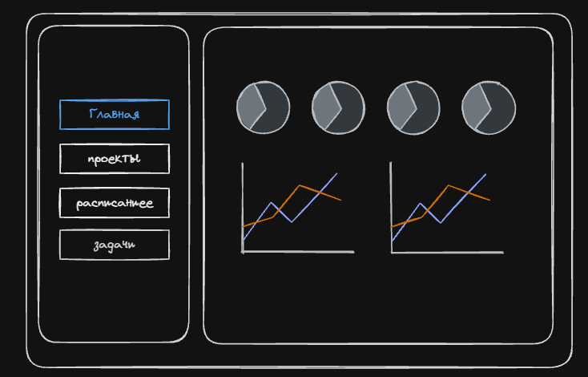
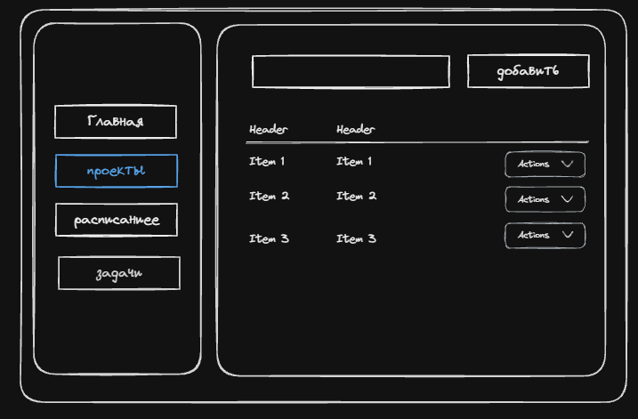
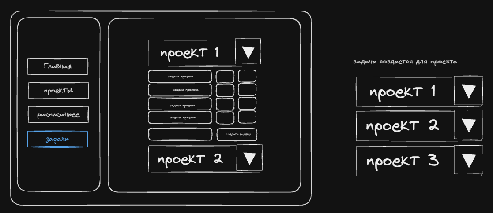
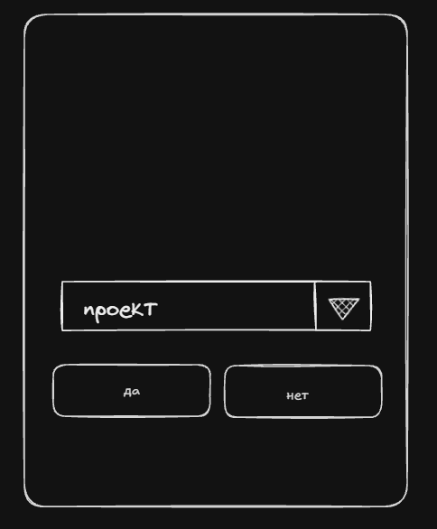

# FlowDeskQt

#### сектчи первого видения

#### приложение придумано для того, чтоб контролирровать свое расписание и свой распорядок дня

1) приложение работает автономно
2) приложение хранит проекты
3) приложение хранит задачи
4) приложение спрашивает, что ты сделал за период времени
5) приложение уведомляет о проектах которые застаиваются
6) приложение ведет учет эффективности работы и рабочих процессов
7) приложение сворачивается в трей
8) приложение помогает создавать личное расписание и следовать ему
9) приложение имеет приятный интерфейс
10) приложение следит за активностью

